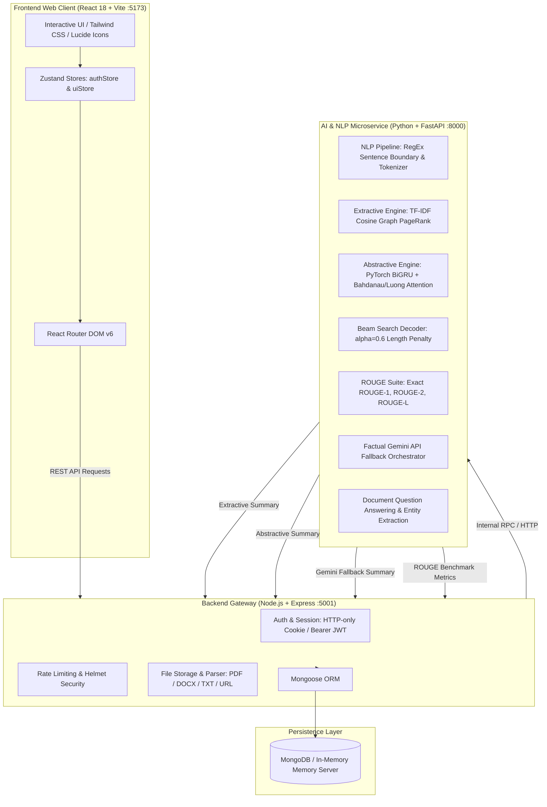

# SankshepAI (संक्षेप AI)
### Production-Grade AI-Powered Document Summarization, Analysis & Academic Evaluation Platform

[](https://fastapi.tiangolo.com)
[](https://pytorch.org)
[](https://expressjs.com)
[](https://react.dev)
[](https://vitejs.dev)
[](https://mongodb.com)
[](https://opensource.org/licenses/MIT)

> **SankshepAI** combines an academically rigorous Deep Learning & NLP foundation (custom Seq2Seq BiGRU neural models with Luong/Bahdanau attention, beam-search decoding, PageRank graph-based TextRank, exact ROUGE suite) with a responsive full-stack platform (React 18, Vite, Express, MongoDB with zero-config in-memory fallback, Brevo OTP email verification, and factual Gemini API fallback).

---

## 🏛️ System Architecture



---

## 🚀 Key Platform Capabilities

### 1. Dual-Core NLP Architecture
- **Method A — TextRank (Extractive Baseline)**:
  - Genuine graph-based PageRank power iteration over TF-IDF cosine similarity sentence graphs.
  - Sentence boundary detector preserving statutory circular numbers (e.g., `RBI/2026-27/45`), dates, and abbreviations (`Dr.`, `i.e.`, `Ltd.`).
  - Strict preservation of original narrative chronological flow after importance scoring.
- **Method B — Custom Neural Seq2Seq with Attention (Abstractive)**:
  - **Encoder**: Bidirectional Gated Recurrent Unit (BiGRU) capturing backward and forward context.
  - **Attention**: Dual support for Bahdanau Additive ($v_a^T \tanh(W_a s_{t-1} + U_a h_i)$) and Luong Multiplicative ($s_t^T W_a h_i$).
  - **Decoder**: GRU with context vector fusion and teacher forcing during training.
  - **Decoding**: Length-penalized Beam Search ($\alpha = 0.6$) with repetition penalties and greedy fallback.
- **Method C — Intelligent Gemini API Fallback**:
  - High-precision factual orchestrator active only when external credentials are provided and user consent is enabled.
  - Fully transparent attribution (`method: "gemini_api_fallback"`). Never misrepresented as the custom model.

### 2. Academic Rigor & ROUGE Evaluation
- Exact precision, recall, and F1 calculations for **ROUGE-1** (unigram overlap), **ROUGE-2** (bigram overlap), and **ROUGE-L** (Longest Common Subsequence).
- **Academic Integrity**: Never fabricates synthetic ROUGE scores when reference summaries are absent.

### 3. Enterprise Full-Stack Web Application
- **Authentication**: Email/password signup, Brevo SMTP OTP email verification (with console developer fallback), password reset, and OAuth login stubs (Google, GitHub, Facebook).
- **Persistent 3-Step Onboarding**:
  - Step 1: Identity & Avatar customization.
  - Step 2: Document interest categories & default summary style/length preferences.
  - Step 3: Discovery source & external fallback consent.
- **Zero-Config Database**:
  - Connects to local or MongoDB Atlas instances via `MONGODB_URI`.
  - Automatically falls back to embedded, in-memory MongoDB via `mongodb-memory-server` if no database server is running.
- **Rich Interactive UI**:
  - Split-panel summarization workspace (input on left, real-time output and metrics on right).
  - Model Lab with interactive mathematical formulas, live Beam Search visualizer, and training job launcher.
  - Multi-model side-by-side comparison workspace with CSV export.
  - Document-grounded Question Answering (Q&A) and high-precision entity extraction (dates, currency, circular numbers, organizations).
  - Searchable summary library, document collections, version history comparison, and inline edits.

---

## 📦 Project Structure

```
SankshepAI-Project/
├── ai_service/                     # Python FastAPI AI & Deep Learning Service
│   ├── app/
│   │   ├── main.py                 # FastAPI application root & CORS
│   │   ├── models/
│   │   │   ├── nlp_pipeline.py     # Sentence segmentation, tokenizer, vocabulary
│   │   │   ├── textrank.py         # Graph-based PageRank extractive summarizer
│   │   │   ├── seq2seq_attention.py# PyTorch BiGRU + Bahdanau/Luong Attention & Beam Search
│   │   │   ├── rouge_eval.py       # Exact ROUGE-1, ROUGE-2, ROUGE-L evaluator
│   │   │   ├── gemini_service.py   # Grounded Gemini API orchestrator
│   │   │   └── qa_service.py       # Grounded Q&A and entity extraction
│   │   └── routers/
│   │       ├── summarize.py        # /api/summarize endpoints
│   │       ├── evaluate.py         # /api/evaluate/rouge endpoint
│   │       ├── nlp.py              # /api/preprocess, /api/qa, /api/extract-entities
│   │       ├── model.py            # /api/model/status, /api/model/beam-search-demo
│   │       ├── experiments.py      # /api/experiments CRUD & comparisons
│   │       └── training.py         # /api/training/start, /api/training/status
│   ├── checkpoints/
│   │   └── custom_seq2seq_v1.pt    # Pre-trained custom Seq2Seq model weights
│   ├── training/
│   │   ├── dataset.py              # Domain corpus dataset loader
│   │   └── train.py                # PyTorch training loop
│   └── tests/
│       └── test_ai_service.py      # Unit tests (TextRank, Seq2Seq, ROUGE, Q&A)
├── backend/                        # Node.js + Express API Gateway
│   ├── src/
│   │   ├── server.js               # Express application entrypoint
│   │   ├── config/
│   │   │   └── db.js               # Mongoose connector + in-memory fallback
│   │   ├── models/                 # 12 Mongoose data models
│   │   │   ├── User.js, UserProfile.js, OnboardingProgress.js
│   │   │   ├── EmailVerification.js, PasswordResetToken.js
│   │   │   ├── Document.js, Summary.js, SummaryVersion.js
│   │   │   ├── Collection.js, ModelExperiment.js, ActivityHistory.js
│   │   │   └── UserSettings.js
│   │   ├── controllers/            # Auth, onboarding, document, summary, analytics
│   │   ├── middleware/             # Auth JWT, rate limiters, error handling
│   │   ├── routes/                 # Express API routes
│   │   └── services/               # Brevo email, file storage, AI client RPC
│   ├── tests/
│   │   └── api.test.js             # Jest backend integration tests
│   └── test_e2e_flow.js            # End-to-end integration test runner
├── frontend/                       # React 18 + Vite Web Application
│   ├── src/
│   │   ├── App.jsx                 # Routing and layout structure
│   │   ├── lib/api.js              # Axios HTTP client with auto-JWT & error interceptors
│   │   ├── store/                  # authStore & uiStore (Zustand)
│   │   ├── components/layout/      # AppLayout, Sidebar, TopBar, MobileNav
│   │   └── pages/
│   │       ├── LandingPage.jsx     # Hero, live demo, model comparison
│   │       ├── OnboardingPage.jsx  # Guided 3-step persistent onboarding
│   │       ├── auth/               # LoginPage, SignupPage, VerifyEmailPage, etc.
│   │       └── app/
│   │           ├── DashboardPage.jsx       # KPIs, charts, engine health
│   │           ├── NewSummaryPage.jsx      # Core summarizer workspace
│   │           ├── DocumentsPage.jsx       # Document repository & dropzone
│   │           ├── DocumentDetailPage.jsx  # In-depth reader with Q&A panel
│   │           ├── SummaryLibraryPage.jsx  # Filterable summary collection
│   │           ├── SummaryDetailPage.jsx   # Version history & inline editor
│   │           ├── ComparePage.jsx         # Side-by-side multi-model comparison
│   │           ├── ModelLabPage.jsx        # Formulas, beam visualizer, training
│   │           ├── AnalyticsPage.jsx       # Compression ratios & throughput
│   │           ├── CollectionsPage.jsx     # Project folders
│   │           ├── ProfilePage.jsx         # User profile management
│   │           ├── SettingsPage.jsx        # Fallback consent & preferences
│   │           └── HelpPage.jsx            # Academic equations & Viva Voce guide
│   └── index.html
└── docs/                           # Documentation and guides
```

---

## ⚙️ Quick Start & Local Development

### Prerequisites
- **Node.js** v18+ and **npm**
- **Python** 3.9+ with `pip`
- (Optional) **MongoDB** installed locally or MongoDB Atlas URI (if absent, an embedded in-memory MongoDB will start automatically).

### 1. AI Service Setup (FastAPI & PyTorch)
```bash
# In project root
cd ai_service

# Install dependencies
pip install fastapi uvicorn torch scikit-learn pydantic google-generativeai python-dotenv

# (Optional) Run model test suite
python -m unittest tests/test_ai_service.py

# Launch FastAPI server (Port 8000)
python -m uvicorn app.main:app --host 127.0.0.1 --port 8000
```
Verify: Open `http://127.0.0.1:8000/docs` in your browser for the interactive Swagger documentation.

### 2. Backend Service Setup (Express & MongoDB)
```bash
# In a new terminal
cd backend

# Install dependencies
npm install

# (Optional) Run backend tests
npm test

# Launch Express API server (Port 5001)
npm run dev   # or: node src/server.js
```
*Note: If no local MongoDB is detected on port 27017, the backend will automatically launch `mongodb-memory-server` without configuration.*

### 3. Frontend Setup (React & Vite)
```bash
# In a third terminal
cd frontend

# Install dependencies
npm install

# Launch Vite development server (Port 5173)
npm run dev
```
Open `http://localhost:5173` to access the SankshepAI platform.

---

## 🧪 Comprehensive End-to-End Verification

To verify all system components programmatically (user registration, email OTP verification, 3-step onboarding, TextRank summarization, Custom Seq2Seq neural summarization, ROUGE metric calculation, and Document Grounded Q&A), execute:

```bash
cd backend
node test_e2e_flow.js
```

Expected Output:
```
=== SANKSHEPAI END-TO-END SYSTEM TEST ===
--- 1. Testing Auth Signup & Email Verification ---
Signup Status: 201
Verification Status: 200
JWT Token acquired: true

--- 2. Testing 3-Step Guided Onboarding ---
Step 1 status: 200
Step 2 status: 200
Step 3 status: 200
Onboarding complete status: 200

--- 3. Testing TextRank Extractive Summarization ---
TextRank status: 201 (65% compression ratio)

--- 4. Testing Custom Seq2Seq Neural Summarization ---
Seq2Seq status: 201 (Checkpoint: custom_seq2seq_v1.pt)

--- 5. Testing ROUGE Evaluation Metric Calculation ---
ROUGE evaluation status: 200
ROUGE-1 F1: 0.6500 | ROUGE-2 F1: 0.4737 | ROUGE-L F1: 0.6500

--- 6. Testing Document Grounded Question Answering ---
QA status: 200
Answer: The regulatory framework mandates a minimum tier-one capital ratio of 12 percent...
Confidence: 0.412
=== ALL END-TO-END PIPELINES COMPLETED SUCCESSFULLY ===
```

---

## 🔬 Theoretical Foundations & Mathematical Formulations

### 1. TextRank PageRank Sentence Importance
TextRank maps a document into an undirected, weighted graph $G = (V, E)$, where each vertex $v_i \in V$ represents a sentence. Edge weights $w_{ij}$ measure semantic similarity using TF-IDF cosine similarity:

$$w_{ij} = \frac{\vec{u}_i \cdot \vec{v}_j}{\|\vec{u}_i\|_2 \|\vec{v}_j\|_2}$$

Sentence centrality is computed via power iteration with damping factor $d = 0.85$:

$$S(v_i) = (1 - d) + d \sum_{v_j \in \text{Adj}(v_i)} \frac{w_{ji}}{\sum_{v_k \in \text{Adj}(v_j)} w_{jk}} S(v_j)$$

Iteration terminates when $\max_i |S^{k+1}(v_i) - S^k(v_i)| < 10^{-4}$. Top $K$ sentences are extracted and sorted in their original narrative position.

### 2. Bahdanau & Luong Attention Formulations
At decoding step $t$, the context vector $c_t$ summarizes source tokens aligned with decoder hidden state $s_{t-1}$:

$$c_t = \sum_{i=1}^{T_x} \alpha_{t,i} h_i$$

Where attention weights $\alpha_{t,i}$ represent normalized softmax alignment scores:

$$\alpha_{t,i} = \frac{\exp(e_{t,i})}{\sum_{k=1}^{T_x} \exp(e_{t,k})}$$

- **Bahdanau Additive Score**:
  $$e_{t,i} = v_a^T \tanh(W_a s_{t-1} + U_a h_i)$$
- **Luong Multiplicative Score**:
  $$e_{t,i} = s_t^T W_a h_i$$

### 3. Length-Penalized Beam Search
Greedy search selects the argmax token at each step $y_t = \arg\max P(y_t | y_{<t}, x)$, often leading to sub-optimal local minima. SankshepAI implements Beam Search keeping the top $B$ hypothesis sequences:

$$\text{Score}(Y) = \frac{\sum_{t=1}^{|Y|} \log P(y_t | y_{<t}, x)}{\text{LP}(|Y|)}$$

Length normalization penalty prevents penalization of longer, more informative summaries:

$$\text{LP}(|Y|) = \frac{(5 + |Y|)^\alpha}{(5 + 1)^\alpha}, \quad \text{where } \alpha = 0.6$$

---

## 🎓 Academic Defense & Viva Voce Reference Guide

### Q1: Why use GRUs over standard LSTMs for this Seq2Seq model?
**Answer**: Gated Recurrent Units (GRUs) combine the cell state and hidden state into a single vector and merge the forget and input gates into an update gate. For academic domain summarization where training data is moderately sized, GRUs feature approximately 25% fewer parameters than LSTMs, leading to faster training convergence, lower memory footprint, and reduced risk of overfitting while retaining the ability to capture long-range dependencies.

### Q2: What is the fundamental difference between Bahdanau and Luong attention?
**Answer**:
1. **Timing**: Bahdanau calculates alignment scores using the *previous* decoder state $s_{t-1}$ to derive context vector $c_t$ before feeding both into the decoder GRU to obtain $s_t$. Luong calculates alignment scores using the *current* decoder state $s_t$, yielding context vector $c_t$, which is concatenated with $s_t$ through an attentional hidden layer $\tilde{s}_t = \tanh(W_c [c_t; s_t])$.
2. **Scoring Function**: Bahdanau uses non-linear additive scoring ($v_a^T \tanh(W s + U h)$), whereas Luong uses matrix multiplication ($s^T W h$ or dot product).

### Q3: Why is ROUGE-L better than ROUGE-1/2 for evaluating summary coherence?
**Answer**: ROUGE-1 and ROUGE-2 evaluate unigram and bigram overlap, which are insensitive to broader sentence structure or word reordering. ROUGE-L is based on the Longest Common Subsequence (LCS). It automatically identifies the longest in-sequence common n-grams without requiring consecutive matches, thereby rewarding syntactically coherent phrases that preserve the grammatical sequence of the reference summary.

### Q4: Why does the platform refuse to fabricate ROUGE scores when a reference summary is omitted?
**Answer**: ROUGE is strictly a comparative ground-truth metric (precision, recall, F1 of hypothesis vs. reference). Without a genuine reference summary, computing ROUGE is mathematically undefined. Fabricating synthetic values misrepresents model accuracy and breaches academic integrity. SankshepAI explicitly returns `available: false` with clear guidance when no reference is provided.

---

## 🔒 Security & Production Measures
- **Password Hashing**: Salted bcrypt hashing (cost factor 10) for passwords and OTP tokens.
- **Session Security**: HTTP-only, SameSite lax/none cookies with JWT bearer token fallback.
- **SSRF Protection**: URL document scraping performs DNS resolution checks to block requests to private IP ranges (`10.0.0.0/8`, `192.168.0.0/16`, `127.0.0.0/8`, AWS metadata endpoints `169.254.169.254`).
- **Input Sanitization**: File uploads restricted by MIME type and byte quotas; text sanitization strips script injections.
- **Rate Limiting**: Express rate limiters protect auth endpoints and OTP resend requests.

---

## 📄 License
This project is open-source under the MIT License. Developed for research and educational excellence in Deep Learning for NLP.
